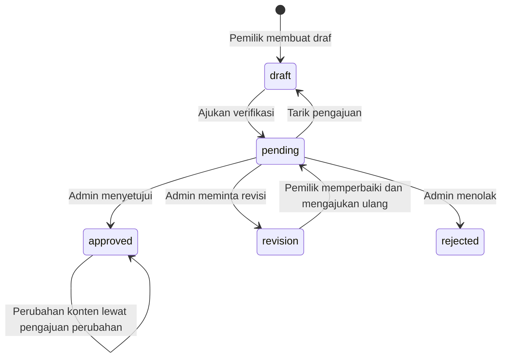
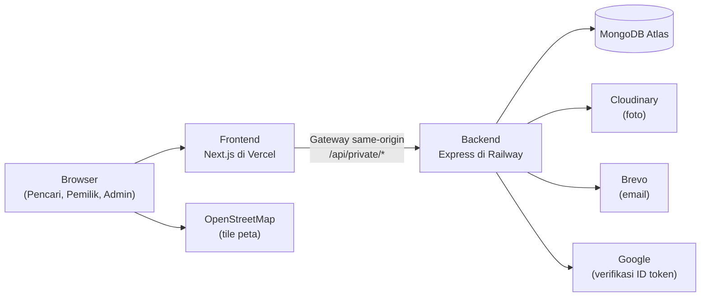
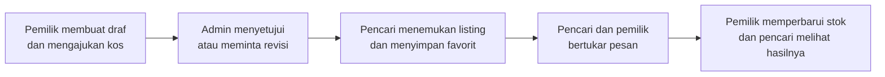

# Singgah Sana

**Portal pencarian dan pengelolaan kos terverifikasi.**
Tugas Akhir Mata Kuliah Pengembangan Aplikasi Web (PAW) · DTETI FT UGM · User Story 2 (US2)

| | |
| --- | --- |
| **Aplikasi (Frontend)** | https://singgah-sana.vercel.app |
| **API (Backend)** | https://singgah-sana-production.up.railway.app/api |
| **Repositori** | https://github.com/ZeFaranddd/singgah-sana |

> Data kos pada lingkungan demo adalah **data simulasi**, bukan penawaran sewa yang telah diverifikasi di lapangan. Cakupan hasil pencarian mengikuti data yang tersedia di sistem, bukan jaminan kelengkapan seluruh daerah.

---

## Daftar Isi

1. [Tentang Aplikasi](#1-tentang-aplikasi)
2. [Tim](#2-tim)
3. [User Story dan Fitur](#3-user-story-dan-fitur)
4. [Alur Verifikasi Listing](#4-alur-verifikasi-listing)
5. [Teknologi](#5-teknologi)
6. [Arsitektur dan Struktur Folder](#6-arsitektur-dan-struktur-folder)
7. [Ringkasan Endpoint API](#7-ringkasan-endpoint-api)
8. [Menjalankan Secara Lokal](#8-menjalankan-secara-lokal)
9. [Deployment](#9-deployment)
10. [Pengujian](#10-pengujian)
11. [Panduan Demo](#11-panduan-demo)
12. [Batasan yang Diketahui](#12-batasan-yang-diketahui)
13. [Kaitan dengan Rubrik Penilaian](#13-kaitan-dengan-rubrik-penilaian)

---

## 1. Tentang Aplikasi

Mencari kos sering kali melelahkan: informasi tersebar di pamflet dan grup pesan, jumlah kamar tersedia tidak selalu terbarui, dan sebagian informasi tidak akurat. Di sisi lain, pemilik kos terus ditanya tentang kamar yang sebenarnya sudah penuh.

**Singgah Sana** menghubungkan tiga peran dalam satu platform:

- **Pencari kos** mencari, memfilter, membandingkan, menyimpan favorit, dan menghubungi pemilik.
- **Pemilik kos** mengelola listing, mengunggah foto, memperbarui stok kamar, dan membalas pesan.
- **Admin** meninjau setiap pengajuan listing sebelum tampil ke publik.

### Keunggulan

- **Terverifikasi.** Listing baru tidak langsung tayang. Hanya kos berstatus *approved* yang muncul di katalog publik.
- **Pencarian multifilter.** Kata kunci/lokasi, rentang harga, tipe (putra/putri/campur), fasilitas, dan ketersediaan kamar. Hasil tersedia sebagai daftar maupun peta interaktif.
- **Informasi tetap akurat.** Perubahan konten melewati pengajuan, sementara data publik lama dipertahankan sampai perubahan disetujui. Stok kamar dapat diperbarui mandiri oleh pemilik.
- **Komunikasi awal langsung.** Pencari dapat bertanya kepada pemilik melalui percakapan di dalam aplikasi.

### Batasan lingkup

Singgah Sana berfokus pada **informasi kos dan komunikasi awal**. Aplikasi tidak mencakup booking maupun pembayaran, dan pengiriman pesan (*inquiry*) tidak menahan atau mengurangi stok kamar.

---

## 2. Tim

| Anggota | NIM | Bagian frontend | Bagian backend |
| --- | --- | --- | --- |
| Stella Florencia Doulim | 24/542739/TK/60285 | Publik dan UI bersama | Authentication, JWT Security & RBAC |
| Farand Hafiz | 24/540618/TK/60027 | Pencari dan akun | Pencari dan akun | Backend Architecture & Core Kos Management |
| Faiz Gymnastiar Wibawa | 24/537851/TK/59634 | Ruang pemilik | Ruang pemilik | Inquiry System, Favorit & Postman Testing |
| Aurelia Mutiah Raudyatuzzahra | 24/534903/TK/59310 | Ruang admin | Ruang admin | Admin Verification Workflow & Reporting/Export |

---

## 3. User Story dan Fitur

| # | User story | Fitur yang tersedia | Alasan diadakan |
| :-: | --- | --- | --- |
| 1 | Sebagai **pencari**, saya ingin mencari dan memfilter kos berdasarkan lokasi, tipe, harga, fasilitas, dan ketersediaan kamar. | Pencarian multifilter, tampilan daftar dan peta (Leaflet/OpenStreetMap). | Informasi kos tersebar dan sulit dibandingkan secara manual. |
| 2 | Sebagai **pencari**, saya ingin melihat detail dan lokasi kos, menyimpan favorit, serta mengirim pesan kepada pemilik. | Halaman detail (galeri foto, fasilitas, lokasi), favorit, percakapan dengan pemilik, profil, dan notifikasi. | Mempercepat keputusan dan memudahkan kontak awal. |
| 3 | Sebagai **pemilik**, saya ingin mengelola listing dan memperbarui jumlah kamar tersedia. | Draf, unggah foto, pengajuan verifikasi, pengajuan perubahan, pembaruan stok, pengarsipan listing, balasan pesan. | Informasi ketersediaan selalu sesuai kondisi terbaru. |
| 4 | Sebagai **admin**, saya ingin meninjau pengajuan listing sebelum tampil ke publik. | Antrean pengajuan, perbandingan data sebelum dan sesudah, keputusan setujui / revisi / tolak dengan catatan, audit log, daftar kos dan pengguna, statistik, ekspor CSV. | Hanya informasi yang sudah diperiksa yang tampil ke publik. |

### Fitur pendukung

- Registrasi dan login dengan sesi aman, **Google Sign-In**, verifikasi email, serta pemulihan kata sandi melalui email.
- Pengelolaan profil, preferensi notifikasi, dan penghapusan akun mandiri dengan konfirmasi.
- Halaman bantuan, privasi, dan ketentuan layanan.

---

## 4. Alur Verifikasi Listing



- Draf dan pengajuan yang belum disetujui **tidak muncul di publik**.
- Pemilik dapat **menarik** pengajuan yang masih `pending`.
- Keputusan admin (`approved`, `revision`, `rejected`) disertai catatan dan **dicatat dalam audit log**.
- Setelah listing `approved`, perubahan konten diajukan sebagai **pengajuan perubahan** (`before` dan `after`); data publik lama tetap tayang sampai perubahan disetujui.
- Pemilik dapat **mengarsipkan** listing; listing terarsip tidak tampil di publik.

---

## 5. Teknologi

| Kategori | Teknologi |
| --- | --- |
| **Frontend** | Next.js (App Router), React, TypeScript, Tailwind CSS, Lucide (ikon), Leaflet dan react-leaflet (peta) |
| **Backend** | Node.js, Express.js, MongoDB dengan Mongoose |
| **Autentikasi dan keamanan** | Sesi server dengan cookie HttpOnly, proteksi CSRF, bcrypt (hash kata sandi), otorisasi berbasis peran (RBAC), rate limiting. JWT tersedia untuk penggunaan API yang secara eksplisit diizinkan. |
| **Pihak ketiga** | **Cloudinary** (penyimpanan foto), **Leaflet + OpenStreetMap** (peta), **Brevo HTTPS API** (email transaksional), **Google Identity Services** (Google Sign-In) |
| **Database** | MongoDB Atlas |
| **Deployment** | **Vercel** (frontend) dan **Railway** (backend) |
| **Pengujian dan tooling** | Jest dan Supertest (backend, dengan MongoDB sementara), `tsx --test` (frontend), Postman (koleksi API), ESLint, TypeScript, GitHub Actions (CI) |

Versi paket yang dipakai berada di `package.json` dan dikunci oleh `package-lock.json` pada masing-masing folder. Gunakan `npm ci` untuk instalasi.

---

## 6. Arsitektur dan Struktur Folder



```text
backend/
  src/controllers/  # request/response HTTP
  src/services/     # aturan bisnis dan integrasi
  src/models/       # skema MongoDB
  src/routes/       # endpoint
  src/middlewares/  # sesi, otorisasi, CSRF, validasi, rate limit
  src/dto/          # bentuk data respons
  src/scripts/      # pemeliharaan data, tidak berjalan saat startup
  tests/            # tes API dengan MongoDB sementara
frontend/
  src/app/          # halaman Next.js dan gateway backend
  src/components/   # UI bersama/publik
  src/features/     # data dan logika fitur bersama
  src/modules/      # fitur akun, pemilik, admin
  src/lib/          # normalisasi, format, gateway, utilitas
  test/             # tes kontrak, adapter, sesi, alur
docs/               # laporan milestone
postman/            # koleksi dan environment API
```

### Rute utama frontend

| Area | Rute |
| --- | --- |
| Publik | `/`, `/jelajah`, `/kos/[id]`, `/bantuan`, `/privasi`, `/ketentuan` |
| Autentikasi | `/masuk`, `/daftar`, `/lupa-sandi`, `/reset-sandi`, `/verifikasi-email` |
| Pencari | `/favorit`, `/pesan`, `/akun` (profil, keamanan, notifikasi) |
| Pemilik | `/pemilik`, `/pemilik/kos`, `/pemilik/kos/baru`, `/pemilik/pesan` |
| Admin | `/admin`, `/admin/kos`, `/admin/review`, `/admin/users`, `/admin/audit-logs` |

---

## 7. Ringkasan Endpoint API

Seluruh endpoint berada di bawah prefiks `/api`. Dari browser, permintaan terautentikasi melewati gateway frontend `/api/private/*`.

| Prefiks | Fungsi |
| --- | --- |
| `/api/auth` | Registrasi, login, logout, sesi, profil, kata sandi, Google Sign-In, verifikasi email, pemulihan sandi |
| `/api/kos` | Daftar dan detail kos publik (hanya listing `approved`) |
| `/api/pemilik/kos` | Draf, pengajuan, penarikan, pengajuan perubahan, stok (`/ketersediaan`), publikasi/arsip, hapus |
| `/api/media` | Unggah dan hapus foto |
| `/api/favorit` | Daftar, simpan, dan hapus favorit |
| `/api/inquiries` | Percakapan antara pencari dan pemilik |
| `/api/notifikasi` | Daftar dan penandaan notifikasi |
| `/api/admin` | Antrean pengajuan, keputusan verifikasi, audit log, kos, pengguna, statistik, ekspor CSV |

Contoh yang sering dipakai: `GET /api/kos`, `GET /api/kos/:id`, `POST /api/pemilik/kos/:id/ajukan`, `PATCH /api/pemilik/kos/:id/ketersediaan`, `PATCH /api/admin/pengajuan/:id/keputusan`. Koleksi lengkap tersedia di folder `postman/`.

---

## 8. Menjalankan Secara Lokal

### Prasyarat

- **Node.js** yang memenuhi `engines` paket Next.js terpasang (Node 22 LTS disarankan).
- **MongoDB yang mendukung transaksi**: MongoDB Atlas atau replica set lokal.

### Langkah

1. Salin `backend/.env.example` menjadi `backend/.env` dan `frontend/.env.example` menjadi `frontend/.env.local`, lalu isi nilai lokal. **Jangan commit berkas environment atau kredensial.**
2. Jalankan backend:

   ```sh
   cd backend
   npm ci
   npm run dev
   ```

3. Jalankan frontend di terminal lain:

   ```sh
   cd frontend
   npm ci
   npm run dev
   ```

Frontend berjalan di `http://localhost:3000` dan backend di `http://localhost:5000`. Samakan `APP_ORIGIN` pada kedua sisi dengan origin frontend, dan arahkan `API_BASE_URL` frontend ke backend dengan akhiran `/api`.

> **Seeder** hanya untuk database demo yang terpisah. Baca guard pada `backend/src/utils/seeder.js` dan jangan menjalankannya terhadap database produksi atau data penting.

---

## 9. Deployment

- **Frontend:** Vercel, root directory `frontend`, build `npm run build`.
- **Backend:** Railway, root directory `backend`, start `npm start`.
- **Database:** MongoDB Atlas.

Pastikan kedua sisi men-deploy commit yang sama. Push yang berhasil belum tentu berarti deployment berhasil.

| Lokasi | Variabel | Keterangan |
| --- | --- | --- |
| Railway | `NODE_ENV` | `production` |
| Railway | `MONGO_URI` | URI database Atlas |
| Railway | `JWT_SECRET`, `SESSION_SECRET` | Rahasia acak yang kuat; jangan pakai nilai contoh |
| Railway | `APP_ORIGIN` | `https://singgah-sana.vercel.app` |
| Railway | `BASE_URL` | `https://singgah-sana-production.up.railway.app` |
| Railway | `CLOUDINARY_CLOUD_NAME`, `CLOUDINARY_API_KEY`, `CLOUDINARY_API_SECRET` | Penyimpanan foto |
| Railway | `BREVO_API_KEY` | API key HTTPS Brevo, **bukan** SMTP key |
| Railway | `MAIL_FROM` | Nama dan alamat pengirim yang sudah terverifikasi |
| Railway | `GOOGLE_CLIENT_ID` | Client ID Google Web, sama dengan frontend |
| Vercel | `API_BASE_URL` | `https://singgah-sana-production.up.railway.app/api` |
| Vercel | `APP_ORIGIN` | `https://singgah-sana.vercel.app` |
| Vercel | `NEXT_PUBLIC_GOOGLE_CLIENT_ID` | Client ID publik Google Web |

Catatan penting:

- Daftarkan origin frontend pada **Authorized JavaScript origins** di Google Cloud.
- Variabel `NEXT_PUBLIC_*` dibaca saat build; setelah mengubahnya, lakukan build dan deploy ulang.
- Jangan menaruh API secret atau URI MongoDB dalam variabel publik frontend. Alur Google Identity Services memverifikasi ID token di backend, tanpa client secret di browser.

### Jika email reset sandi tidak masuk

1. Pastikan deployment backend terbaru aktif, `BREVO_API_KEY` adalah API key HTTPS, `MAIL_FROM` terverifikasi, dan `APP_ORIGIN` benar.
2. Periksa *transactional logs* Brevo dan log Railway (penolakan autentikasi, sender, kuota, timeout, bounce, suppression). Jangan menampilkan nilai key atau token di log.
3. Uji dengan akun yang kotak masuknya benar-benar dikuasai tim.
4. Respons formulir sengaja sama untuk alamat terdaftar dan tidak terdaftar, sehingga HTTP 200 **tidak** membuktikan email terkirim. Konfirmasi bahwa email masuk, tautan membuka domain produksi, sandi baru berfungsi, dan tautan yang sama tidak bisa dipakai ulang.

---

## 10. Pengujian

```sh
# Backend (MongoDB in-memory replica set, bukan MONGO_URI produksi)
cd backend
npm test

# Frontend
cd frontend
npm run lint
npm run typecheck
npm test
npm run build
```

- Pipeline **GitHub Actions** menjalankan tes frontend, typecheck, dan build pada setiap push dan pull request.
- Pengujian endpoint juga dapat dilakukan dengan **Postman** menggunakan koleksi pada folder `postman/`.

---

## 11. Panduan Demo

Alur yang disarankan:



1. **Publik (tanpa login):** buka beranda, cari area, buka `/jelajah`, coba filter dan tampilan peta, lalu buka detail kos.
2. **Pemilik:** masuk, tambah kos baru di `/pemilik/kos/baru`, unggah foto, simpan draf, lalu ajukan verifikasi. Tunjukkan bahwa kos berstatus *pending* dan belum muncul di `/jelajah`.
3. **Admin:** buka `/admin/review`, periksa pengajuan, lalu setujui. Segarkan `/jelajah` untuk menunjukkan kos kini tayang.
4. **Pencari:** simpan kos ke favorit dan kirim pesan ke pemilik.
5. **Pemilik:** balas pesan di `/pemilik/pesan`, lalu ubah jumlah kamar tersedia. Tunjukkan perubahannya di sisi pencari.
6. **Nilai tambah:** tunjukkan alur lupa sandi (dengan jeda pengiriman ulang) dan halaman `/akun/keamanan`.

Tips:

- Gunakan **profil browser berbeda** untuk setiap peran (misalnya pencari, pemilik, dan admin di jendela Incognito), karena sesi memakai cookie dan login baru akan menimpa sesi sebelumnya.
- Pastikan koneksi internet stabil agar tile peta OpenStreetMap termuat.
- Percakapan diperbarui melalui *polling*, jadi segarkan atau buka percakapan lawan untuk melihat balasan terbaru.
- Gunakan akun demo yang sudah disiapkan, dan **jangan mereset database produksi** untuk keperluan demo. Kredensial akun demo dibagikan melalui kanal tim, bukan melalui README ini.
- Periksa tampilan pada desktop, tablet, dan ponsel, termasuk menu, dialog, daftar admin, chat, pemilihan foto, serta keadaan kosong, gagal, dan memuat.

---

## 12. Batasan yang Diketahui

- Percakapan memakai *polling*, bukan WebSocket.
- Google Sign-In, verifikasi email, dan reset sandi bergantung pada konfigurasi penyedia yang valid.
- Akun Google tanpa kata sandi harus membuat kata sandi melalui pemulihan email sebelum dapat menghapus akun.
- Perubahan alamat email belum tersedia pada antarmuka.
- Tidak ada fitur booking maupun pembayaran.
- Data demonstrasi adalah simulasi.

---

## 13. Kaitan dengan Rubrik Penilaian

| Aspek | Bukti pada aplikasi |
| --- | --- |
| **G1 / US2** | Data kos lengkap, filter, favorit, kontak pemilik, stok, tiga peran, verifikasi sebelum publikasi |
| **BE1 – BE2** | Express modular (routes, controllers, services, middlewares) dan MongoDB/Mongoose dengan indeks |
| **BE3** | CRUD kos dan draf, pengajuan perubahan, pembaruan ketersediaan, audit log |
| **BE4 – BE5** | Hash sandi, validasi, kepemilikan data, otorisasi peran, sesi server dan proteksi CSRF |
| **FE1 – FE5** | Next.js/React/TypeScript, komponen modular, layout responsif, umpan balik (loading, toast, error), validasi formulir, gateway ke backend |
| **G6** | Leaflet/OpenStreetMap, Cloudinary, Brevo, Google Sign-In, serta deployment Vercel dan Railway |

---

*Proyek ini dikerjakan oleh Kelompok Singgah Sana untuk mata kuliah Pengembangan Aplikasi Web, Departemen Teknik Elektro dan Teknologi Informasi, Fakultas Teknik, Universitas Gadjah Mada.*
